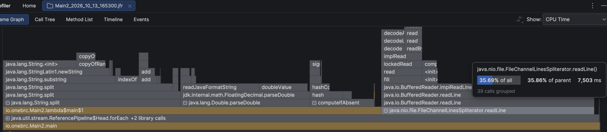
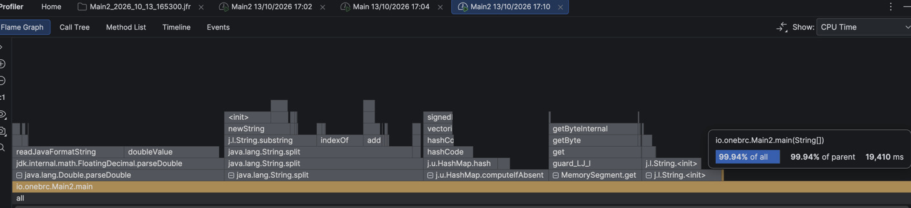
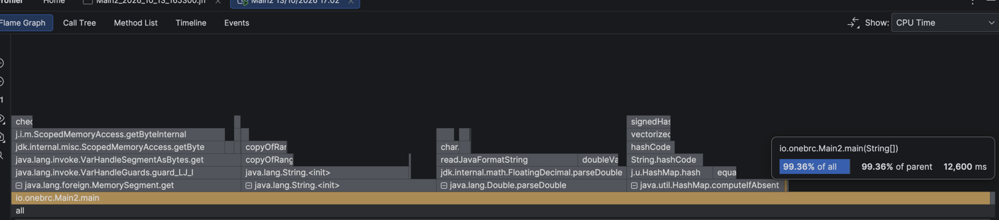
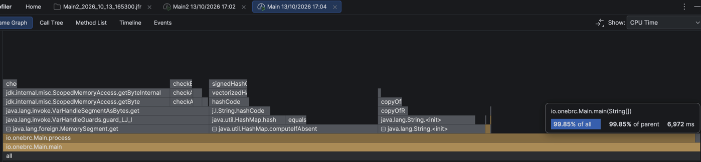
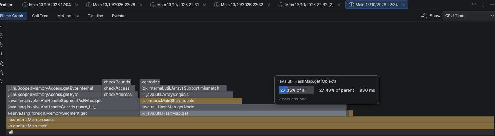
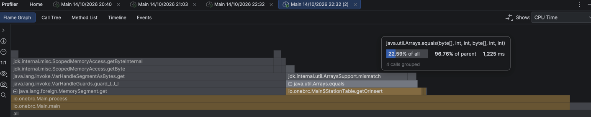
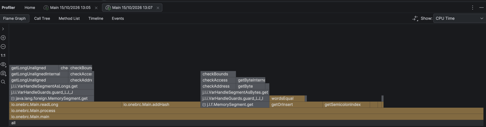
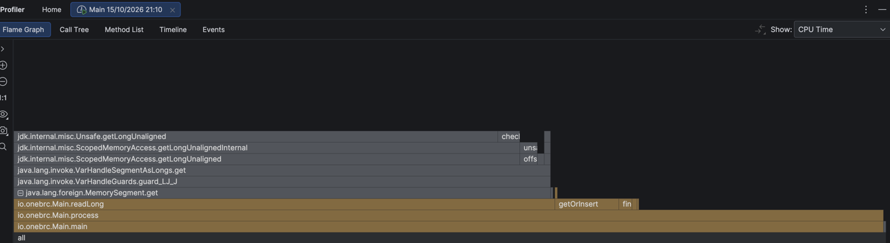
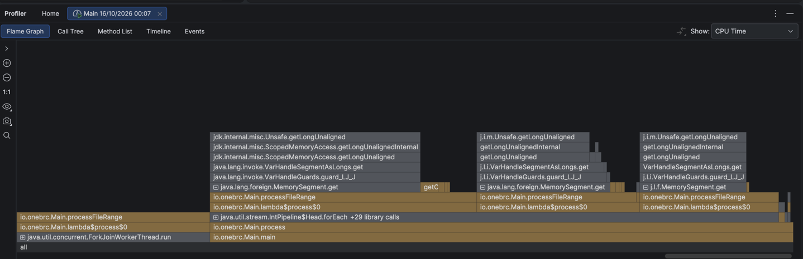

# 1BRC in Java: optimization log

From 21s to 0.5s on 100M rows, one profiler-guided pass at a time.

## Setup

| | |
|---|---|
| Machine | Apple M1 Pro: 8 cores (6 performance + 2 efficiency), 16 GB RAM, macOS |
| JDK | OpenJDK 21 (Temurin) |
| Dataset | `measurements_100M.txt`: 100M rows, 1.4 GB (stays in page cache) |
| Profiler | IntelliJ IDEA Profiler (JFR), CPU Time flame graph |
| Timing | `evaluate_100M.sh`: `hyperfine --warmup 1 --runs 10` |

Times marked † are the profiler's total CPU time. I used those until I switched to hyperfine, and from Pass 3 on every time is hyperfine wall time. The two are different measurements, so only compare times measured the same way.

The 1B times come from my commit messages, and they don't scale 10× from 100M. Pass 6 took 1.7s on 100M, which would predict 17s for 1B, but the 1B run took 43.9s. The 14 GB file likely doesn't stay in page cache next to the JVM and the IDE on 16 GB of RAM, so the 1B runs include disk reads.

## Results

| Pass | Change | 100M | 1B |
|---|---|---|---|
| 1 | Baseline: `Files.lines` + `split` + `parseDouble` + `HashMap<String>` | 21.0s† | 204.6s |
| 2 | mmap + parse bytes by hand | 7.0s† | 83.2s |
| 3 | `byte[]` key instead of `String` | 2.98s | 62.6s |
| 4 | Custom open-addressing hash table | 2.65s | 59.8s |
| 5 | Read and compare the name 8 bytes at a time as `long` | 1.8s | 46.6s |
| 6 | Branch-free temperature parsing, first 2 name words as fields | 1.7s | 43.9s |
| 7 | Drop the per-read bound check | ~1.7s (no change) | 42.2s |
| 8 | Parallel chunks, one table per chunk | 0.5s | 13.5s |

Each pass below starts from what the previous profile showed, then describes the idea it led to and the result. The flame graph at the end of a pass is the evidence for the next one.

## Pass 1: Baseline (21.0s†)

The baseline reads each line with `Files.lines`, splits it with `line.split(";")`, parses the temperature with `Double.parseDouble` and aggregates with `HashMap<String, Stats>.computeIfAbsent`.

In the profile, `readLine` takes 36%, `String.split` about 29%, `parseDouble` about 21% and the `HashMap` about 11%.

## Pass 2: mmap + parse bytes by hand (21.0s† → 7.0s†)

The three biggest frames in Pass 1, `readLine`, `split` and `parseDouble`, all do the same kind of work. They turn text into objects: a `String` for every line, then substrings and a `String[]`, then text into a `double`. The aggregation itself, the `HashMap`, is only about 11%.

I removed those object-creating steps one at a time and profiled again after each one.

First, I replaced `readLine` with mmap (`MemorySegment`). The code now scans the mapped bytes for `\n` itself, but it still does `new String` for every line. That brought the time down to 19.4s†.

Second, instead of calling `split`, I found the `;` in the same byte scan. The name and the temperature were each still turned into a `String`. That got it to 12.6s†.

Third, I replaced `parseDouble` with code that parses the digits straight into an `int` of tenths, so `-12.3` becomes `-123`. That reached 7.0s†.

The mmap step saved only about 2s, even though `readLine` had been 7.5s of the profile. The reason is that `readLine` did three jobs: getting the bytes, finding the `\n` and building the `String`. The mmap version still does the last two, which now show up as `MemorySegment.get` (about 2.6s) and `String.<init>` (about 2.1s). Copying the file was never the cost. Here is each piece measured in isolation:

| Step | Time |
|---|---|
| `read()` the whole file into a 1 MB buffer (all the copying) | 0.1s |
| mmap: touch one byte per 16 KB page (page faults) | 0.2s |
| mmap: byte loop finding `\n` | 1.9s |
| mmap: byte loop + `new String` per line | 3.5s |
| `Files.lines` (read + decode + `readLine` + `String`) | 5.6s |

The lesson is that, to estimate a saving, you have to subtract *all* the new frames that still do the old job, and then confirm end to end with hyperfine, not with a single profiling run.

## Pass 3: `byte[]` key instead of `String` (→ 2.98s)

In Pass 2's profile, `HashMap.computeIfAbsent` is about 24% (`String.hashCode`, `equals`) and `String.<init>` about 16%. Both costs exist only because the program still builds a `String` for every line to use as a map key, which then gets hashed and compared.

I switched to using the name bytes as the key. One reusable `Key`, holding a scratch buffer, the length and a hash computed while scanning, does every lookup. The bytes get copied into a new `Key` only the first time a station shows up.

This is also where timing moves to hyperfine wall time, so the 2.98s can't be compared directly with Pass 2's 7.0s†.

## Pass 4: Custom hash table (2.98s → 2.65s)

With the `String` gone, the map itself is the next cost. In Pass 3's profile, `HashMap.get` is 27%, spent in `getNode` → `Key.equals` → `Arrays.equals`. Every lookup goes through several layers (virtual `hashCode`/`equals`, node objects), all for a table of only ~413 keys.

I replaced it with my own open-addressing table: 2^14 slots with linear probing, indexed by the precomputed hash. On a probe, it compares the hash and the length first and looks at the bytes only if both match. One `Entry` holds both the name and the stats.

## Pass 5: 8 bytes at a time (2.65s → 1.8s)

In Pass 4's profile, about 47% is `MemorySegment.get` → `getByte`, which reads one byte per call and checks bounds and liveness on every call. Another 23% is `Arrays.equals`, comparing names byte by byte.

Both come down to handling one byte at a time, so the fix is to read 8 bytes at once as a little-endian `long`. To find the `;` inside that `long`, I used a SWAR bit trick. XOR with `;;;;;;;;` turns the `;` byte into `00`, and `(x - 0x0101…) & ~x & 0x8080…` then marks it. Names are hashed and compared as `long[]` as well, so a typical name takes 1 or 2 compares instead of about 10.

## Pass 6: Branch-free temperature (1.8s → 1.7s)

About 14% of Pass 5's profile is still `MemorySegment.get` → `getByte`. That is the temperature, which was still parsed byte by byte, with branches on the sign and the digit count, both of which depend on random data. On top of that, `getOrInsert` (about 11%) runs a `wordsEqual` loop on every lookup.

I made two changes. The temperature is now read as one `long`. A bit trick finds the `.`, since digits have bit 4 set and `.` doesn't, and then shifts and one multiply compute the value with no branches (credit: merykitty, royvanrijn). I also kept the first two name words as fields on `Entry`, so most lookups are two `long` compares with no loop.

## Pass 7: Drop the per-read bound check (~1.7s, no change)

In Pass 6's profile, about 62% of the samples are in `readLong` → `MemorySegment.get` → `getLongUnaligned`, and `readLong` checks `offset + 7 < fileSize` on every read.

A line reads at most 108 bytes past its start, so I let every line that starts more than 128 bytes before EOF use a plain `file.get`. The last ≤128 bytes are copied into a zero-padded buffer and parsed by the same code.

It made no difference on 100M. On 1B the time went from 43.9s to 42.2s, which is likely run-to-run noise. The check was always true, so the branch predictor always got it right and it cost almost nothing. The profiler puts the time on the load because that's where the CPU waits. Each line's reads depend on where the previous line ended, and new pages cause page faults.

The lesson is that a hot load means "waiting for data", not "the read code is slow". Removing predictable instructions that aren't on that chain of dependent steps doesn't save time.

## Pass 8: Parallel chunks (1.7s → 0.5s)

Every profile so far shows one thread, `main`, mostly waiting on that chain of dependent loads, while 7 of the 8 cores sit idle.

So I split the file into line-aligned chunks and parsed them in a parallel `IntStream`. Each chunk gets its own `StationTable`, so there's no sharing and no locks, and the tables are merged by station name at the end. There are 128 chunks (8 cores × 16), so the 6 performance cores can take more chunks than the 2 efficiency cores. Reads may cross a chunk's end by a few bytes, which is harmless because the mapping is read-only.

The work is now spread across `ForkJoinWorkerThread`s, and each one is still dominated by `MemorySegment.get`. On 1B the run took 13.5s, far from 10 × 0.5s, which fits the page-cache note in Setup.
